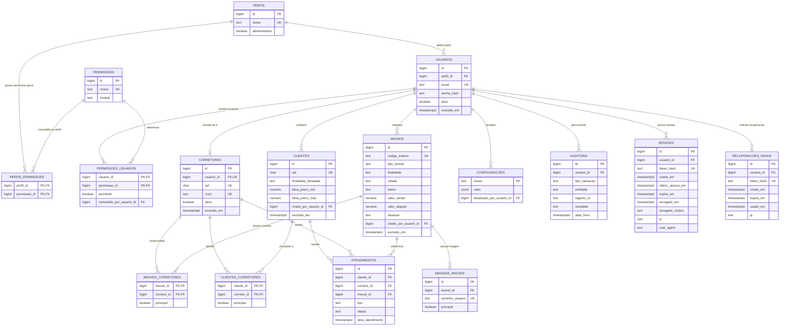

# Modelo de dados do ImobManager

Etapas 02 e 04 — modelagem inicial e tabelas de autenticação no PostgreSQL.

## Diagrama ER



## Tabelas

| Tabela               | Finalidade                                                                 |
| -------------------- | -------------------------------------------------------------------------- |
| `perfis`             | Perfis de acesso; `administrativo = true` identifica o Administrador.      |
| `usuarios`           | Contas de acesso; podem ou não ter registro de corretor.                    |
| `permissoes`         | Catálogo de permissões funcionais por módulo.                              |
| `perfis_permissoes`  | Permissões gerais concedidas a cada perfil.                                |
| `permissoes_usuarios`| Exceções individuais (`permitido = true/false`) por usuário.               |
| `corretores`         | Dados profissionais, vinculados a um usuário não administrativo.           |
| `clientes`           | Clientes e preferências de compra/locação.                                 |
| `imoveis`            | Imóveis, localização, características, valores e situação.                 |
| `imagens_imoveis`    | Imagens dos imóveis; no máximo uma principal por imóvel.                   |
| `imoveis_corretores` | Vínculo N:N entre imóveis e corretores responsáveis.                       |
| `clientes_corretores`| Vínculo N:N entre clientes e corretores responsáveis.                      |
| `atendimentos`       | Histórico de atendimentos, com cliente, corretor e imóvel opcional.        |
| `configuracoes`      | Configurações chave/valor em JSONB.                                        |
| `auditoria`          | Eventos de segurança e operação, sem dados sensíveis desnecessários.       |
| `sessoes`            | Sessões autenticadas; armazena apenas o hash do token.                     |
| `recuperacoes_senha` | Tokens de recuperação de senha com uso único e validade curta.             |

## Relacionamentos principais

- Um perfil possui vários usuários; cada usuário possui exatamente um perfil.
- O Administrador é identificado por `perfis.administrativo = true` e não precisa de registro em `corretores`, mantendo o acesso administrativo independente da operação.
- Cada corretor está vinculado a um usuário ativo, com unicidade garantida por índice parcial que ignora registros excluídos logicamente.
- Clientes e imóveis podem ser vinculados a vários corretores; o campo `principal` define o responsável e é único por registro (índice parcial).
- Um atendimento referencia obrigatoriamente um cliente e um corretor, e opcionalmente um imóvel.
- A auditoria preserva o `usuario_id` quando possível e também o e-mail no momento do evento.
- Um usuário pode ter várias sessões e várias solicitações de recuperação; ambas são
  removidas em cascata se o usuário for excluído fisicamente.

## Permissões: precedência

1. **Exceção individual** em `permissoes_usuarios`: se existir registro para o usuário e a permissão, `permitido = true` concede e `permitido = false` revoga, independentemente do perfil.
2. **Permissão geral** em `perfis_permissoes`: aplicada quando não há exceção individual.
3. **Negação por padrão**: sem permissão no perfil e sem exceção, o acesso é negado.

As duas origens ficam em tabelas separadas por exigência do projeto. O backend deve consultar a exceção individual antes da permissão do perfil (etapa 05). Todo acesso a permissões administrativas continuará sendo validado no servidor.

## Visibilidade de imóveis e clientes

Configurada em `configuracoes`:

| Chave                   | Valores permitidos        | Padrão inicial |
| ----------------------- | ------------------------- | -------------- |
| `imoveis.visibilidade`  | `"todos"`, `"vinculados"` | `"todos"`      |
| `clientes.visibilidade` | `"todos"`, `"vinculados"` | `"todos"`      |

- `todos`: o corretor visualiza todos os registros.
- `vinculados`: o corretor visualiza apenas registros ligados a ele nas tabelas de vínculo.
- As duas chaves são independentes e podem ser combinadas pelo administrador.
- Exceções individuais para recursos específicos de outros corretores serão implementadas na etapa 05, com precedência sobre a regra geral de visibilidade.

## Sessões e recuperação de senha

Adicionadas pela migration `002_auth_sessions`:

- `sessoes.token_hash` e `recuperacoes_senha.token_hash` são únicos e validados como 64
  caracteres hexadecimais; o token utilizável nunca é armazenado.
- `expira_em > criado_em` é garantido por `CHECK` nas duas tabelas.
- A revogação de sessão exige `revogado_em` e `revogado_motivo` preenchidos em conjunto.
- Tokens de recuperação são de uso único (`usado_em`); uma nova solicitação consome os
  pendentes anteriores.
- Redefinir a senha atualiza `senha_alterada_em`, limpa bloqueio e tentativas e revoga
  todas as sessões abertas do usuário.
- Índices cobrem usuário, expiração e registros ainda ativos (`WHERE revogado_em IS NULL`
  e `WHERE usado_em IS NULL`).
- Exclusão física do usuário remove sessões e recuperações em cascata.

## Exclusão lógica

- `usuarios`, `corretores`, `clientes` e `imoveis` usam `excluido_em`.
- Índices únicos parciais ignoram registros excluídos, permitindo reutilizar e-mail, CPF, CRECI e código interno após exclusão lógica.
- `atendimentos` e `auditoria` não possuem exclusão física pela aplicação: atendimentos usam `status = 'cancelado'` e auditoria é somente inclusão.
- A exclusão física de um imóvel remove imagens e vínculos em cascata; atendimentos mantêm o histórico com `imovel_id = NULL`.

## Integridade e índices

- Chaves estrangeiras nomeadas com `ON DELETE` explícito (RESTRICT, CASCADE ou SET NULL).
- `CHECK` para formatos de CPF (11 dígitos), CEP (8 dígitos), estado (UF), e-mail normalizado em minúsculas, valores não negativos, faixas de preço coerentes e enums de domínio.
- Índices para filtros frequentes: cidade, bairro, tipo, finalidade, situação, preços, nomes e datas de atendimento.
- Índices GIN para `imoveis.caracteristicas` e índices parciais para `ativo`/`situacao`.
- Triggers mantêm `atualizado_em` em todas as tabelas que possuem a coluna.
- Migration registrada em `schema_migrations` com checksum SHA-256 para detectar alterações após aplicação.

## Dados de referência

A migration cria apenas dados de referência, não dados de negócio:

- Perfis `Administrador` (administrativo) e `Corretor`.
- Catálogo com 24 permissões.
- Administrador com todas as permissões; Corretor com 14 permissões operacionais iniciais.
- Configurações de visibilidade padrão.

## Operação

```bash
npm run migrate:status   # situação das migrations
npm run migrate:up       # aplica migrations pendentes
npm run migrate:down     # reverte a última migration aplicada
npm run db:check         # testes de integridade (rollback ao final)
```
